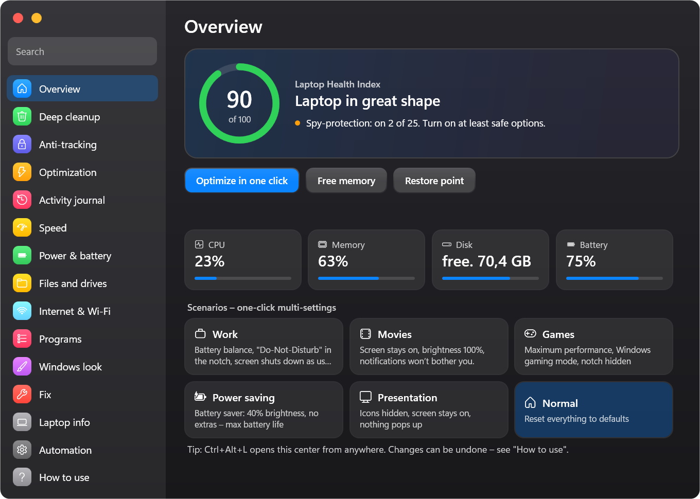
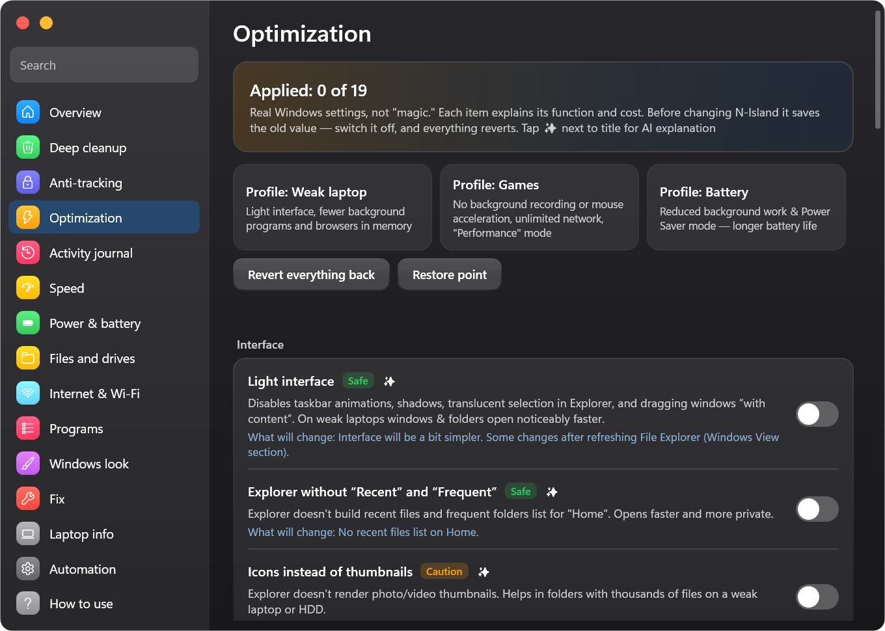

<div align="center">


# N-Island

**Dynamic Island for Windows — plus a beginner-friendly Laptop Control Center**

**English** · [Русский](docs/readme/README.ru.md) · [Українська](docs/readme/README.uk.md)

[](https://github.com/Neizvestnyi22/N-Island/releases/latest)
[](https://github.com/Neizvestnyi22/N-Island/releases)


[](LICENSE)

*made in TG [@Ne1zvestny1i](https://t.me/Ne1zvestny1i) & Claude*

</div>

---

An iPhone-style notch at the top of your screen that shows **music from any app with synced lyrics, calls, notifications, timers and an AI chat** — and a full **Laptop Control Center**: deep cleanup with strict safety checks, anti-tracking, fine-grained Windows optimization, an activity journal (which apps and sites used your camera, mic, location…), power, network, apps and one-click fixes.
Every option has a safety label, a plain-language explanation and an undo button. Works even on weak laptops (Lite mode) and uses ~15–40 MB of RAM.

<p align="center">
  
</p>

## ⬇️ Download

| File | For whom |
|---|---|
| [**NIsland-win-x64.zip**](https://github.com/Neizvestnyi22/N-Island/releases/latest) | **Recommended.** 64-bit Windows 10/11. Everything included, nothing to install. |
| [NIsland-win-x86.zip](https://github.com/Neizvestnyi22/N-Island/releases/latest) | Old 32-bit Windows 10 laptops and netbooks. |
| [NIsland-win-x64-lite.exe](https://github.com/Neizvestnyi22/N-Island/releases/latest) | Small download. Needs the free [.NET 8 Desktop Runtime](https://dotnet.microsoft.com/download/dotnet/8.0) (Windows offers to install it on first launch). |

1. Download, unzip anywhere, run `NIsland.exe` — no installer, no admin rights needed.
2. If SmartScreen says *“Windows protected your PC”* → **More info → Run anyway** (the app isn't code-signed; the source is right here).
3. Hover the notch to expand it, right-click for settings, **Ctrl+Alt+L** for the Laptop Control Center.

Checksums are in `SHA256SUMS.txt` in every release.

## ✨ Features

### The island
- **Music from any app or website** — Spotify, YouTube / YouTube Music, Yandex Music, VK, Apple Music, AIMP, browsers, Telegram… (Windows media controls).
  Cover, progress in the notch, shuffle / repeat / ±10 s / speed, history and favorites.
- **Synced lyrics with karaoke** — LRCLIB with NetEase as a fallback, per-song timing offset that is remembered, line translation, focus mode, offline cache.
- **Calls** from apps *and* websites (Telegram, WhatsApp, Discord, Teams, Zoom, Meet in the browser…) with a timer and a “back to call” button.
- **Notifications** from all apps: 2FA codes with a copy button, important keywords that break through Do Not Disturb, block list, privacy mode.
- **AI chat** right in the notch: free provider without a key, Claude, OpenAI, Gemini, Groq, DeepSeek, Mistral, OpenRouter, Ollama, LM Studio and your own providers. Keys are encrypted with Windows DPAPI.
- Timer, stopwatch, Pomodoro, to-dos, calendar with reminders, weather, world clocks, translator, clipboard history, notes, file shelf, launcher, prayer times, water tracker, sound mixer per app, 30+ API tools (speed test, IP, DNS, QR, currency, units…).
- **15 styles** (liquid glass, frosted, iPhone, neon, **AMOLED** pure black…), 7 modes (Do Not Disturb, Focus, Game, Presentation…), deep customization and transparency.
- **Proper sounds** — chimes, marimba, bell, alarm; synthesized on the fly, per event, with volume.

### Laptop Control Center (Ctrl+Alt+L)
<p align="center">
  
  
</p>

| Section | What it does |
|---|---|
| **Overview** | Laptop health score 0–100 with tips, live CPU/RAM/disk/battery, one-click optimize, restore point, scenarios (Work, Movie, Games, Battery saver, Presentation). |
| **Deep cleanup** | Temp files, browser caches (cache only — never passwords, history or cookies), Discord/Telegram/Spotify/Teams/VS Code/Steam caches, crash dumps, update leftovers, activity traces. A “Don't touch” list explains myths (Prefetch, WinSxS, Installer…). |
| **Optimization** | 20 real Windows settings (light UI, Game Bar recording, mouse acceleration, network throttling, GPU scheduling, background apps, widgets, Edge/Chrome in background, SysMain, search indexing, hibernation, Fast Startup, Delivery Optimization, AutoPlay…), ready profiles (Weak laptop, Games, Battery) and **per-app tuning**: GPU preference, permanent CPU priority, compatibility flags. |
| **Anti-tracking** | 25 items: telemetry, advertising ID, activity history, Copilot, Recall, Bing in Start, DiagTrack, data-collection tasks, Edge data… plus a tracker-blocking hosts list. |
| **Activity journal** | Who used the camera, microphone and location — when and for how long; what websites are allowed in your browsers; which programs ran and when; who sent notifications; what was installed; which USB drives were connected. |
| **Speed, Power, Files, Internet, Programs, Fix** | Power mode, battery health and 80 % charge alert, sleep timer, duplicate/large/old files, DNS switcher (Cloudflare, AdGuard…), “who is online now”, startup advisor, uninstaller, 14 official fixes (SFC, DISM, chkdsk, audio, network, printer, time, Store, icons…). |

Next to every option there is a **✨ button** — the AI explains in plain words what it does, who should enable it, the risks and how to undo it.

### Safety first
- Only **documented Windows settings and policies** — no patched system files, no “magic registry packs”.
- Before every change the original value is saved (`%APPDATA%\NIsland\backup`) — **flip the switch back and it's restored**.
- Admin rights are requested **only for a specific action** through the standard Windows prompt; the exact script is kept in `%APPDATA%\NIsland\admin` so you can read it.
- Cleanup deletes only inside a whitelist of cache folders, never follows links/junctions, skips system, locked and fresh files, and cleans an app's cache only when the app is closed. Your files always go to the Recycle Bin.
- System files are repaired only by Windows' own tools (SFC, DISM).

### For weak PCs
**Lite mode** switches off glass blur, the equalizer and shadows and is enabled automatically on laptops with ≤4 GB RAM, 2 threads or no GPU acceleration. Pages are created only when opened; idle memory is about 15–40 MB.

### Languages
Русский, English, Українська — built in, works offline (Settings → Language).

## ⌨️ Hotkeys

| Keys | Action |
|---|---|
| Ctrl+Alt+N | open the island |
| Ctrl+Alt+L | Laptop Control Center |
| Ctrl+Alt+A | AI chat |
| Ctrl+Alt+H / D | hide the island / Do Not Disturb |
| Ctrl+Alt+C / V / T | color picker / clipboard / translator |

## 🖥 Requirements
Windows 10 version 2004 (build 19041) or newer, or Windows 11. x64 or x86. 4 GB RAM is enough.

## ❓ FAQ
**Is it safe? Will it break Windows?** Everything is reversible and labelled *Safe / Caution / Not recommended*. Items marked “Not recommended” are explanations only — they can't be applied. Create a restore point on the Overview page before big changes if you like.

**Antivirus complains.** Some antiviruses flag unsigned apps that change system settings. The full source code is here — build it yourself if you prefer (see below).

**Where is my data?** `%APPDATA%\NIsland` — settings, notes, backups. Nothing is sent anywhere. Network is used only for features you use: lyrics (LRCLIB, optional NetEase), weather (Open-Meteo), translation, the AI provider you choose, API tools and a manual update check on GitHub.

**How to uninstall?** Turn off “Start with Windows” in Settings, exit from the tray menu, delete the folder and `%APPDATA%\NIsland`.

## 🛠 Build from source
```powershell
git clone https://github.com/Neizvestnyi22/N-Island.git
cd N-Island
dotnet build -c Release          # .NET 8 SDK
.\build.ps1                      # release zips and exe into dist\
```
UI strings are written in Russian; translations live in `Assets/i18n/*.json` and are generated by `tools/I18nGen`
(`dotnet run --project tools/I18nGen -- . en uk`). Fixes to translations are welcome — just edit the JSON.

Project layout: `IslandWindow` (the notch), `Pages/` (notch pages), `SettingsWindow*.cs` (settings and Control Center), `Services/` (media, lyrics, calls, cleanup, privacy, optimization, activity, AI…), `Core/` (settings, sounds, i18n, presets).

## 📜 License
[MIT](LICENSE) © 2026 [@Ne1zvestny1i](https://t.me/Ne1zvestny1i). Built together with Claude (Anthropic). Version history — [CHANGELOG.md](CHANGELOG.md).
