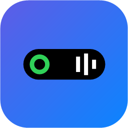
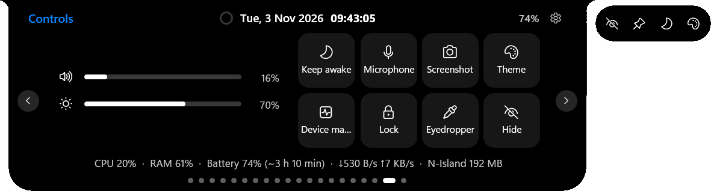

# N-Island

**Dynamic Island pour Windows — et un Centre de contrôle du portable pensé pour les débutants**

[English](../../README.md) · [Русский](README.ru.md) · [Українська](README.uk.md) · [Deutsch](README.de.md) · [Español](README.es.md) · **Français** · [Português](README.pt.md) · [Polski](README.pl.md) · [Türkçe](README.tr.md)

*made in TG [@Ne1zvestny1i](https://t.me/Ne1zvestny1i) & Claude*

---

Une encoche façon iPhone en haut de l'écran : **musique de n'importe quelle appli avec paroles synchronisées, appels, notifications, minuteurs et chat IA** —
ainsi qu'un **Centre de contrôle du portable** : nettoyage approfondi sécurisé, anti-pistage, optimisation fine de Windows, journal d'activité, énergie, réseau et réparations en un clic.
Chaque option a une étiquette de sécurité, une explication simple et peut être annulée.

## ⬇️ Télécharger
| Fichier | Pour qui |
|---|---|
| [**NIsland-win-x64.zip**](https://github.com/Neizvestnyi22/N-Island/releases/latest) | **Recommandé.** Windows 10/11 64 bits, tout inclus. |
| [NIsland-win-x86.zip](https://github.com/Neizvestnyi22/N-Island/releases/latest) | Anciens PC sous Windows 10 32 bits. |
| [NIsland-win-x64-lite.exe](https://github.com/Neizvestnyi22/N-Island/releases/latest) | Léger, nécessite [.NET 8 Desktop Runtime](https://dotnet.microsoft.com/download/dotnet/8.0). |

Décompressez et lancez `NIsland.exe`, sans installation. Si SmartScreen s'affiche : **Informations complémentaires → Exécuter quand même**.
Survolez l'encoche pour l'ouvrir, clic droit = réglages, **Ctrl+Alt+L** = Centre de contrôle. Langue : Réglages → Langue.

## ✨ Fonctions
- Musique de Spotify, YouTube, navigateurs…; paroles en karaoké (LRCLIB, NetEase) et traduction des lignes.
- Appels depuis les applis **et** les sites, notifications avec copie des codes 2FA, chat IA (gratuit sans clé, Claude, OpenAI, Gemini…).
- Minuteur, Pomodoro, tâches, calendrier, météo, traducteur, presse-papiers, notes, mixeur par appli, 30+ outils.
- 15 styles dont **AMOLED**, 7 modes, sons intégrés, **mode léger** pour PC modestes (~15–40 Mo de RAM).
- Centre de contrôle : indice de santé, nettoyage, 20 optimisations Windows réelles + réglages par programme (GPU, priorité CPU, compatibilité),
  25 options de confidentialité, journal d'activité (caméra/micro/position, autorisations des sites, programmes lancés, USB), 14 réparations. ✨ L'IA explique chaque option.

## 🔒 Sécurité
Uniquement des paramètres et stratégies Windows documentés ; les valeurs d'origine sont sauvegardées et restaurées par le même interrupteur.
Droits administrateur seulement pour l'action demandée. Le nettoyage n'agit que dans une liste blanche de caches ; vos fichiers vont à la corbeille.

## 🖥 Configuration
Windows 10 (2004+) ou 11, x64/x86, 4 Go de RAM.

## 📜 Licence
[MIT](../../LICENSE) © 2026 [@Ne1zvestny1i](https://t.me/Ne1zvestny1i). Réalisé avec Claude (Anthropic).
