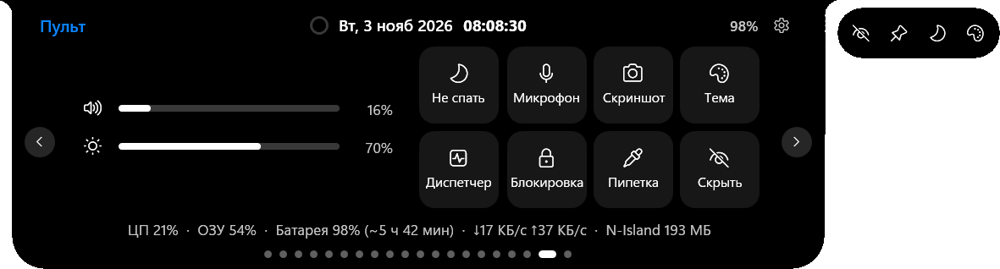
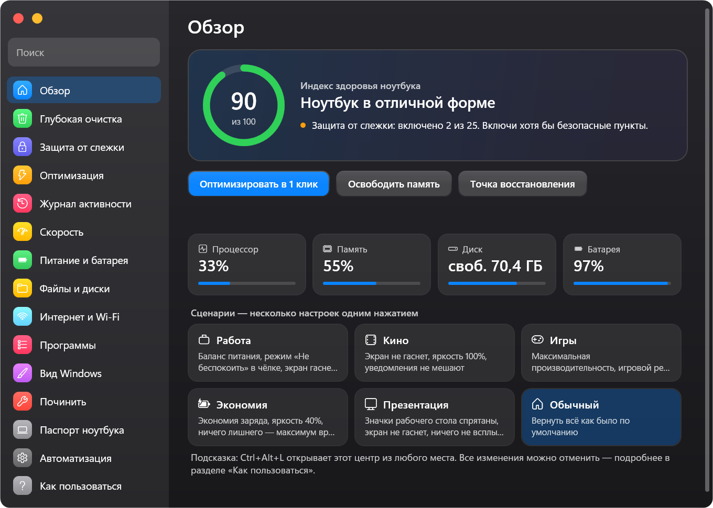
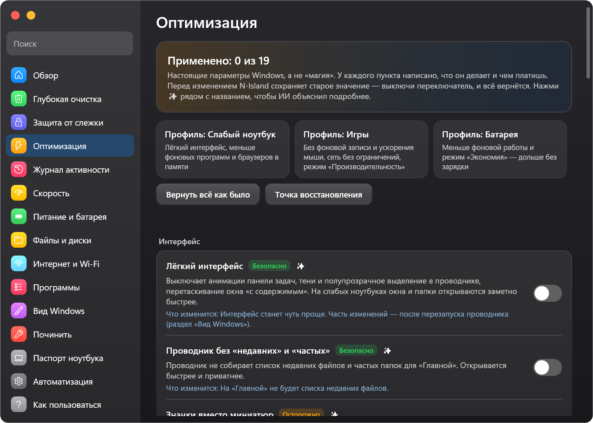

<div align="center">


# N-Island

**Dynamic Island для Windows — и Центр управления ноутбуком, понятный даже новичку**

[English](../../README.md) · **Русский** · [Українська](README.uk.md)

[](https://github.com/Neizvestnyi22/N-Island/releases/latest)

[](../../LICENSE)

*made in TG [@Ne1zvestny1i](https://t.me/Ne1zvestny1i) & Claude*

</div>

---

Чёлка как на iPhone сверху экрана: **музыка из любого приложения с синхронным текстом песни, звонки, уведомления, таймеры и ИИ-чат**.
А ещё — полноценный **Центр управления ноутбуком**: глубокая очистка со строгой проверкой, защита от слежки, тонкая оптимизация Windows,
журнал активности (кто включал камеру, микрофон, что разрешено сайтам…), питание, сеть, программы и исправления в один клик.
У каждого пункта — метка безопасности, объяснение простыми словами и кнопка «вернуть как было». Работает даже на слабых ноутбуках
и занимает около 15–40 МБ памяти.

<p align="center"></p>

## ⬇️ Скачать

| Файл | Для кого |
|---|---|
| [**NIsland-win-x64.zip**](https://github.com/Neizvestnyi22/N-Island/releases/latest) | **Рекомендуется.** 64-битная Windows 10/11. Всё внутри, ничего ставить не нужно. |
| [NIsland-win-x86.zip](https://github.com/Neizvestnyi22/N-Island/releases/latest) | Старые ноутбуки и нетбуки с 32-битной Windows 10. |
| [NIsland-win-x64-lite.exe](https://github.com/Neizvestnyi22/N-Island/releases/latest) | Маленький файл. Нужен бесплатный [.NET 8 Desktop Runtime](https://dotnet.microsoft.com/download/dotnet/8.0) — Windows сама предложит его поставить. |

1. Скачай, распакуй в любую папку и запусти `NIsland.exe`. Установщика нет, права администратора не нужны.
2. Если появится «Windows защитила ваш компьютер» — нажми **Подробнее → Выполнить в любом случае** (у программы нет платной подписи, весь код открыт здесь).
3. Наведи курсор на чёлку — она раскроется. Правый клик — настройки. **Ctrl+Alt+L** — Центр управления ноутбуком.

## ✨ Возможности

### Чёлка
- **Музыка из любого приложения и сайта**: Spotify, YouTube и YouTube Music, Яндекс Музыка, VK, Apple Music, AIMP, браузеры, Telegram…
  Обложка, прогресс прямо в чёлке, перемешивание, повтор, ±10 с, скорость, история и избранное.
  Время трека видно даже в приложениях, которые его не сообщают (Firefox, часть плееров): N-Island считает его сам, а длительность берёт из каталога (помечена «≈»).
- **Синхронный текст песни с караоке**: LRCLIB (точное совпадение по длительности), запасные NetEase и Kugou, **подсветка по словам**, умная чистка названий с YouTube, Spotify и VK, сдвиг текста для каждой песни запоминается, перевод строк, режим фокуса, офлайн-кэш.
- **VPN в острове**: Cloudflare WARP, NordVPN, Mullvad, Windscribe, Tailscale, PIA, OpenVPN, WireGuard и VPN-подключения Windows включаются прямо в острове, остальные VPN показывают состояние. Внешний IP и страна, всплывашка, если VPN отвалился.
- **15 интеграций**: бот Telegram, ntfy, Discord, вебхуки (IFTTT, Zapier, n8n), Home Assistant, Todoist, календарь Google/Outlook/iCloud, GitHub, RSS, ListenBrainz, Last.fm, курсы валют и крипта, посылки Новой пошты, мониторинг сайтов, воздушная тревога (alerts.in.ua).
- **Wi-Fi**: сигнал вживую на графике (найти лучшее место), сети рядом, устройства в сети, полная проверка сети с советами (5 ГГц, загрузка канала, WPS, стандарт роутера и адаптера, задержки и потери, скорость DNS, возраст драйвера), свободные каналы 2,4/5 ГГц, тест скорости.
- **OSINT и проверки**: проверка ссылки на фишинг (раскрытие коротких ссылок, возраст домена, подмена букв, бренд в чужом адресе), WHOIS/RDAP, DNS, сертификаты, поддомены, история в веб-архиве, сведения об IP, утечка пароля (HIBP, пароль не уходит из ПК), метаданные и GPS в фото с чистой копией, хэш файла → VirusTotal.
- **Без дублей**: можно выключить то, что остров уже показывает сам, — баннеры уведомлений Windows (остаются в центре уведомлений), окно «Автозапуск», системное окно громкости. Когда N-Island закрыт, всё возвращается.
- **Быстрый поиск (Ctrl+Alt+Space)** — как Spotlight: программы и приложения Store (даже в другой раскладке), параметры Windows, калькулятор, валюты и единицы, перевод, команды острова («таймер 25», «заметка …»), недавние файлы, буфер, поиск в интернете и **ответ ИИ прямо в окне**.
- **Звонки** из приложений *и сайтов* (Telegram, WhatsApp, Discord, Teams, Zoom, Meet в браузере…) с таймером и кнопкой возврата к звонку.
- **Уведомления** от всех приложений: коды 2FA с кнопкой «Копировать», важные слова сквозь «Не беспокоить», чёрный список, скрытие текста.
- **ИИ-чат** в чёлке: бесплатный без ключа, Claude, OpenAI, Gemini, Groq, DeepSeek, Mistral, OpenRouter, Ollama, LM Studio и свои провайдеры. Ключи шифруются средствами Windows (DPAPI).
- Таймер, секундомер, помодоро, задачи, календарь с напоминаниями, погода, мировые часы, переводчик, история буфера, заметки, полка для файлов,
  запуск программ, намаз, вода, микшер громкости по приложениям, 30+ инструментов (скорость интернета, IP, DNS, QR, курсы, единицы…).
- **15 стилей** (жидкое стекло, матовое, iPhone, неон, **AMOLED** — чисто чёрный…), 7 режимов, глубокая кастомизация и прозрачность.
- **Нормальные звуки**: колокольчики, маримба, колокол, будильник — синтезируются на лету, свой звук на каждое событие, громкость.

### Центр управления ноутбуком (Ctrl+Alt+L)
<p align="center">
  
  
</p>

| Раздел | Что умеет |
|---|---|
| **Обзор** | Индекс здоровья 0–100 с советами, живые показатели, «Оптимизировать в 1 клик», точка восстановления, сценарии (Работа, Кино, Игры, Экономия, Презентация). |
| **Глубокая очистка** | Временные файлы, кэш браузеров (только кэш — пароли, история и входы не трогаются), кэш Discord, Telegram, Spotify, Teams, VS Code, Steam, дампы, остатки обновлений, следы активности. Раздел «Не трогать» объясняет мифы (Prefetch, WinSxS, Installer…). |
| **Оптимизация** | 20 настоящих параметров Windows: лёгкий интерфейс, фоновая запись игр, ускорение мыши, сеть для игр, планирование GPU, фоновые приложения, виджеты, Edge и Chrome в фоне, SysMain, индексирование, гибернация, быстрый запуск, раздача обновлений, автозапуск флешек. Готовые профили «Слабый ноутбук», «Игры», «Батарея» и **тонкая настройка программ**: видеокарта, постоянный приоритет процессора, флаги совместимости. |
| **Защита от слежки** | 25 пунктов: телеметрия, рекламный ID, журнал действий, Copilot, Recall, Bing в Пуске, служба DiagTrack, задания сбора данных, данные Edge… и блокировка трекеров через hosts. |
| **Журнал активности** | Кто и сколько пользовался камерой, микрофоном и местоположением; что разрешено сайтам в браузерах; какие программы и когда запускались; кто присылал уведомления; что устанавливалось; какие флешки подключались. |
| **Скорость, питание, файлы, интернет, программы, починить** | Режим питания, здоровье батареи и сигнал при 80 %, таймер сна, дубликаты и большие файлы, смена DNS (Cloudflare, AdGuard…), «кто сейчас в интернете», советник автозагрузки, удаление программ, 14 официальных исправлений (SFC, DISM, chkdsk, звук, сеть, принтер, время, Store, значки…). |

Рядом с каждым пунктом есть **кнопка ✨** — ИИ простыми словами объяснит, что это, кому включать, какие риски и как вернуть.

### Безопасность на первом месте
- Только **документированные параметры и политики Windows** — никаких подменённых системных файлов и «волшебных твиков».
- Перед любым изменением старое значение сохраняется (`%APPDATA%\NIsland\backup`) — **выключи переключатель, и всё вернётся**.
- Права администратора запрашиваются **только на конкретное действие** обычным окном Windows; сам скрипт лежит в `%APPDATA%\NIsland\admin` — его можно прочитать.
- Очистка удаляет только внутри белого списка папок кэша, не заходит в ярлыки-ссылки, пропускает системные, занятые и свежие файлы и чистит кэш программы, только когда она закрыта. Личные файлы — только в корзину.
- Системные файлы чинятся только встроенными средствами Windows (SFC, DISM).

### Для слабых ПК
**Лёгкий режим** выключает стеклянное размытие, эквалайзер и тени и включается сам на ноутбуках с 4 ГБ памяти, 2 потоками или без видеоускорения. Страницы создаются только при открытии; в простое — около 15–40 МБ памяти.

### Языки
Русский, English, Українська — встроены и работают без интернета («Настройки → Язык»).

## ⌨️ Горячие клавиши

| Клавиши | Действие |
|---|---|
| Ctrl+Alt+N | открыть чёлку |
| Ctrl+Alt+Space | быстрый поиск |
| Ctrl+Alt+L | Центр управления ноутбуком |
| Ctrl+Alt+A | ИИ-чат |
| Ctrl+Alt+H / D | скрыть чёлку / «Не беспокоить» |
| Ctrl+Alt+C / V / T | пипетка / буфер обмена / переводчик |

## 🖥 Требования
Windows 10 версии 2004 (сборка 19041) и новее или Windows 11; x64 или x86; хватит 4 ГБ памяти.

## ❓ Вопросы
**Это безопасно? Не сломает Windows?** Всё обратимо и подписано метками «Безопасно / Осторожно / Не рекомендуется». Пункты «Не рекомендуется» — только объяснения, применить их нельзя. Перед большими изменениями можно создать точку восстановления на странице «Обзор».

**Ругается антивирус.** Некоторые антивирусы настороженно относятся к программам без цифровой подписи, которые меняют настройки системы. Весь код открыт — можно собрать самому (см. ниже).

**Где мои данные?** В `%APPDATA%\NIsland`: настройки, заметки, резервные копии. Никуда не отправляются. Интернет нужен только для функций, которыми ты пользуешься: тексты песен (LRCLIB, по желанию NetEase), погода (Open-Meteo), перевод, выбранный тобой ИИ, инструменты API и проверка обновлений на GitHub по кнопке.

**Как удалить?** Выключи «Запуск вместе с Windows», выйди через значок в трее и удали папку программы и `%APPDATA%\NIsland`.

## 🛠 Сборка из исходников
```powershell
git clone https://github.com/Neizvestnyi22/N-Island.git
cd N-Island
dotnet build -c Release          # нужен .NET 8 SDK
.\build.ps1                      # релизные zip и exe в папку dist\
```
Интерфейс написан по-русски, переводы — в `Assets/i18n/*.json`, их собирает `tools/I18nGen`. Поправить перевод можно прямо в JSON — пулреквесты приветствуются.

## 📜 Лицензия
[MIT](../../LICENSE) © 2026 [@Ne1zvestny1i](https://t.me/Ne1zvestny1i). Сделано вместе с Claude (Anthropic). История версий — [CHANGELOG.md](../../CHANGELOG.md).
