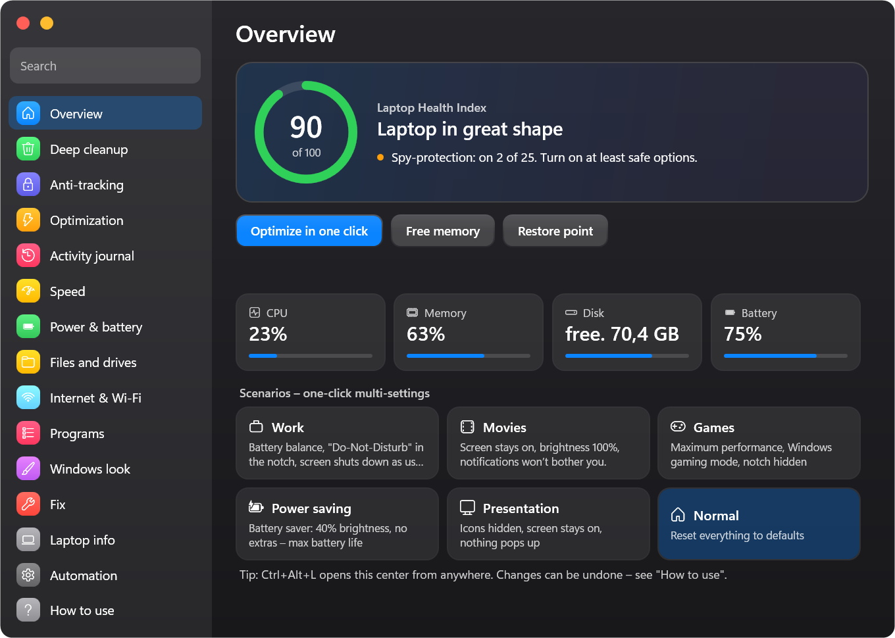
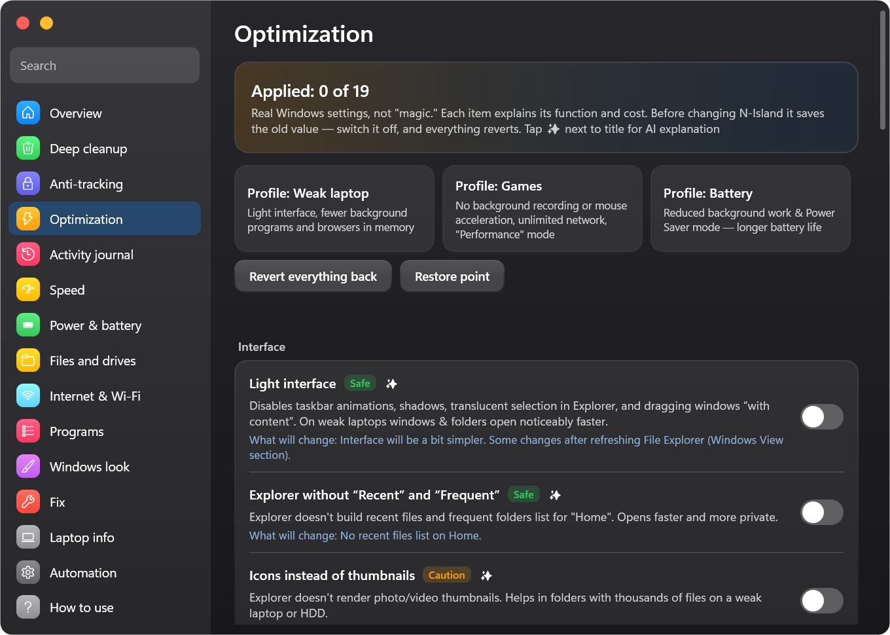

<div align="center">


# N-Island

**Dynamic Island для Windows — і Центр керування ноутбуком, зрозумілий навіть новачку**

[English](../../README.md) · [Русский](README.ru.md) · **Українська**

[](https://github.com/Neizvestnyi22/N-Island/releases/latest)

[](../../LICENSE)

*made in TG [@Ne1zvestny1i](https://t.me/Ne1zvestny1i) & Claude*

</div>

---

«Чубчик» як на iPhone вгорі екрана: **музика з будь-якого застосунку із синхронним текстом пісні, дзвінки, сповіщення, таймери та ШІ-чат**.
А ще — повноцінний **Центр керування ноутбуком**: глибоке очищення із суворою перевіркою, захист від стеження, тонка оптимізація Windows,
журнал активності (хто вмикав камеру, мікрофон, що дозволено сайтам…), живлення, мережа, програми та виправлення в один клік.
Кожен пункт має позначку безпеки, пояснення простими словами та кнопку «повернути як було». Працює навіть на слабких ноутбуках
і займає приблизно 15–40 МБ пам'яті.

<p align="center"></p>

## ⬇️ Завантажити

| Файл | Для кого |
|---|---|
| [**NIsland-win-x64.zip**](https://github.com/Neizvestnyi22/N-Island/releases/latest) | **Рекомендовано.** 64-бітна Windows 10/11. Усе всередині, нічого встановлювати не треба. |
| [NIsland-win-x86.zip](https://github.com/Neizvestnyi22/N-Island/releases/latest) | Старі ноутбуки та нетбуки з 32-бітною Windows 10. |
| [NIsland-win-x64-lite.exe](https://github.com/Neizvestnyi22/N-Island/releases/latest) | Малий файл. Потрібен безкоштовний [.NET 8 Desktop Runtime](https://dotnet.microsoft.com/download/dotnet/8.0) — Windows сама запропонує його встановити. |

1. Завантаж, розпакуй у будь-яку папку й запусти `NIsland.exe`. Інсталятора немає, права адміністратора не потрібні.
2. Якщо з'явиться «Windows захистила ваш комп'ютер» — натисни **Докладніше → Усе одно запустити** (у програми немає платного підпису, весь код відкритий тут).
3. Наведи курсор на «чубчик» — він розгорнеться. Правий клік — налаштування. **Ctrl+Alt+L** — Центр керування ноутбуком.

## ✨ Можливості

### «Чубчик»
- **Музика з будь-якого застосунку та сайту**: Spotify, YouTube і YouTube Music, Apple Music, AIMP, браузери, Telegram… Обкладинка, прогрес, перемішування, повтор, ±10 с, швидкість, історія та обране.
- **Синхронний текст пісні з караоке**: LRCLIB і запасний NetEase, зсув тексту для кожної пісні запам'ятовується, переклад рядків, режим фокусу, офлайн-кеш.
- **Дзвінки** із застосунків *і сайтів* (Telegram, WhatsApp, Discord, Teams, Zoom, Meet у браузері…) з таймером і кнопкою повернення до дзвінка.
- **Сповіщення** від усіх застосунків: коди 2FA з кнопкою «Копіювати», важливі слова крізь «Не турбувати», чорний список, приховування тексту.
- **ШІ-чат**: безкоштовний без ключа, Claude, OpenAI, Gemini, Groq, DeepSeek, Mistral, OpenRouter, Ollama, LM Studio і власні провайдери. Ключі шифруються засобами Windows (DPAPI).
- Таймер, секундомір, помодоро, задачі, календар із нагадуваннями, погода, перекладач, історія буфера, нотатки, полиця для файлів, мікшер гучності, 30+ інструментів.
- **15 стилів** (рідке скло, iPhone, неон, **AMOLED** — чисто чорний…), 7 режимів, глибоке налаштування та прозорість.
- **Нормальні звуки**: дзвіночки, маримба, дзвін, будильник — свій звук на кожну подію, гучність.

### Центр керування ноутбуком (Ctrl+Alt+L)
<p align="center">
  
  
</p>

| Розділ | Що вміє |
|---|---|
| **Огляд** | Індекс здоров'я 0–100 з порадами, живі показники, «Оптимізувати в 1 клік», точка відновлення, сценарії (Робота, Кіно, Ігри, Економія, Презентація). |
| **Глибоке очищення** | Тимчасові файли, кеш браузерів (лише кеш — паролі, історія та входи не зачіпаються), кеш Discord, Telegram, Spotify, Teams, VS Code, Steam, дампи, сліди активності. Розділ «Не чіпати» пояснює міфи. |
| **Оптимізація** | 20 справжніх параметрів Windows, готові профілі «Слабкий ноутбук», «Ігри», «Батарея» і **тонке налаштування програм**: відеокарта, постійний пріоритет процесора, прапорці сумісності. |
| **Захист від стеження** | 25 пунктів: телеметрія, рекламний ID, журнал дій, Copilot, Recall, Bing у «Пуску», служба DiagTrack… і блокування трекерів через hosts. |
| **Журнал активності** | Хто й скільки користувався камерою, мікрофоном і місцезнаходженням; що дозволено сайтам; які програми й коли запускалися; хто надсилав сповіщення; що встановлювалося; які флешки підключалися. |
| **Швидкість, живлення, файли, інтернет, програми, виправлення** | Режим живлення, здоров'я батареї та сигнал на 80 %, таймер сну, дублікати, зміна DNS, «хто зараз в інтернеті», порадник автозавантаження, 14 офіційних виправлень (SFC, DISM, chkdsk…). |

Біля кожного пункту є **кнопка ✨** — ШІ простими словами пояснить, що це, кому вмикати, які ризики та як повернути.

### Безпека
Лише **документовані параметри й політики Windows**; перед кожною зміною старе значення зберігається — **вимкни перемикач, і все повернеться**.
Права адміністратора — лише на конкретну дію через звичайне вікно Windows. Очищення працює тільки в білому списку папок кешу, а особисті файли — лише в кошик.

### Для слабких ПК і мови
**Легкий режим** вимикає скляне розмиття, еквалайзер і тіні та вмикається сам на 4 ГБ пам'яті / 2 потоках / без відеоприскорення.
Мови: Русский, English, Українська — вбудовані, працюють без інтернету.

## 🖥 Вимоги
Windows 10 версії 2004 (збірка 19041) і новіша або Windows 11; x64 або x86; достатньо 4 ГБ пам'яті.

## 🛠 Збірка
```powershell
git clone https://github.com/Neizvestnyi22/N-Island.git
cd N-Island
dotnet build -c Release
.\build.ps1
```

## 📜 Ліцензія
[MIT](../../LICENSE) © 2026 [@Ne1zvestny1i](https://t.me/Ne1zvestny1i). Зроблено разом із Claude (Anthropic).
